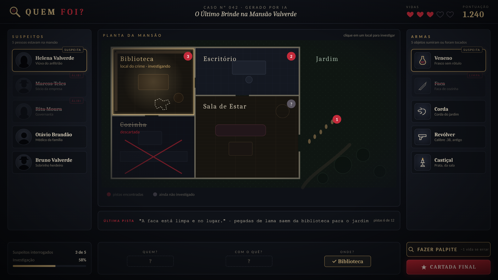
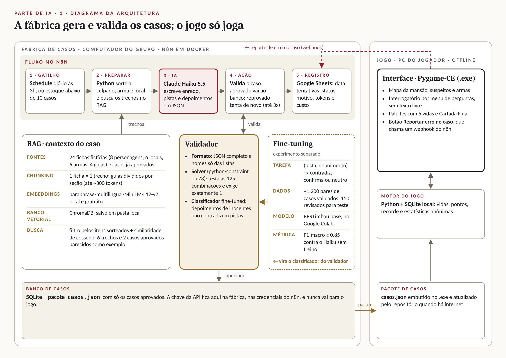

# Quem Foi?

Jogo de dedução para PC em que a IA cria um caso novo a cada partida, e um validador lógico garante que ele tem exatamente uma solução.

**Grupo Mentalistas:** Ana Luiza Lima Nicolodi, Alisson Silva Nascimento e Levi Ramos · Projeto de Inteligência Artificial



## O problema

Jogos de mistério acabam quando o caso é resolvido, e as escolas têm poucas ferramentas engajantes para treinar lógica e análise de evidências. O Quem Foi? é para estudantes a partir de 14 anos, professores e fãs de jogos de detetive: cada partida traz um caso novo e sem furos.

## Como se joga

O jogador investiga uma mansão, coleta pistas e interroga suspeitos para descobrir **quem foi, com que arma e em que lugar**.

- **5 vidas:** cada palpite errado custa uma.
- **Cartada Final:** acusar tudo de uma vez, a qualquer hora. Errou, está eliminado.
- **Pontos:** 100 por caso, +20 por vida restante e +50 pela Cartada Final certa.

## Arquitetura



| Parte | O que faz | Tecnologia |
| --- | --- | --- |
| Fluxo no n8n | Gatilho diário → preparar → IA → validar → registrar | n8n self-hosted (Docker) |
| RAG | Busca trechos das 24 fichas para dar contexto ao caso | MiniLM multilíngue + ChromaDB |
| LLM | Escreve enredo, pistas e depoimentos em JSON | Claude Haiku 5.5 |
| Validador | Exige exatamente 1 solução entre as 125 combinações | python-constraint ou Z3 |
| Fine-tuning | Detecta depoimentos que contradizem pistas | BERTimbau no Google Colab |
| Jogo | Interface offline, lê só casos aprovados | Pygame-CE + PyInstaller |

A chave da API fica só na fábrica de casos (`.env` e credenciais do n8n). O jogo não leva chave nenhuma.

## Pastas

| Pasta | Conteúdo |
| --- | --- |
| `base_conhecimento/` | 24 documentos fictícios do RAG e o `indice.csv` |
| `fabrica/` | Indexação, gerador de casos e validador |
| `n8n/` | Fluxos exportados do n8n |
| `fine_tuning/` | Notebook e resultados do experimento |
| `jogo/` | Jogo em Pygame-CE |
| `docs/` | Entregas, diagramas e imagens |

## Como rodar (a partir da semana 1)

```bash
pip install -r requirements.txt
cp .env.example .env              # coloque sua chave da API
python fabrica/indexar.py         # cria o banco vetorial
python fabrica/gerar_caso.py      # gera e valida um caso
python jogo/main.py               # abre o jogo
```

## Versão mínima em 3 semanas

1. **Gerar:** base no ChromaDB, gerador e solver por linha de comando.
2. **Automatizar:** fluxo no n8n com registro na planilha e 30 casos aprovados.
3. **Jogar:** jogo com 1 mansão, palpites, Cartada Final, vidas, pontos e `.exe`.

Todos os dados do projeto são fictícios e foram criados pelo grupo.
