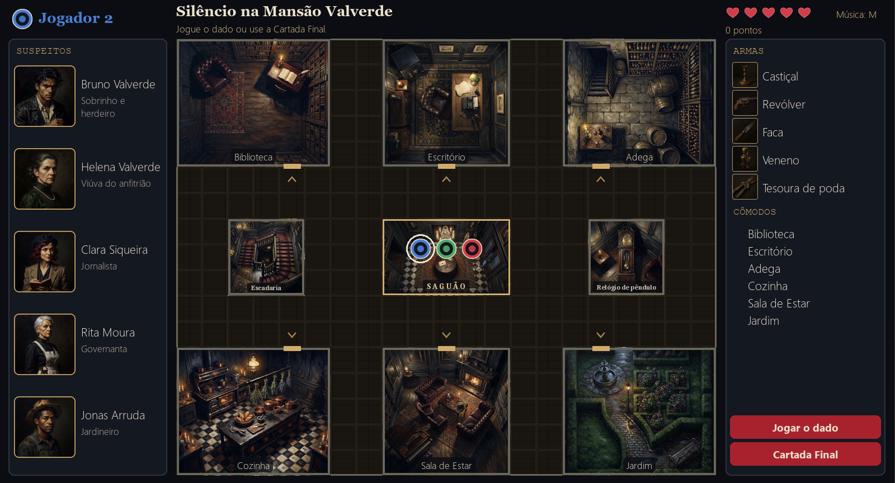

# Quem Foi?

Jogo de dedução para PC em que a IA cria um caso novo a cada partida, e um validador lógico garante que ele tem exatamente uma solução.

**Grupo Mentalistas** · Projeto de Inteligência Artificial

| Nome completo | Matrícula |
| --- | --- |
| Levi Ramos Barbosa Santos | 241070993 |
| Ana Luiza Lima Nicolodi | 241070906 |
| Alisson Silva Nascimento | 241070766 |



## O problema

Jogos de mistério acabam quando o caso é resolvido, e as escolas têm poucas ferramentas engajantes para treinar lógica e análise de evidências. O Quem Foi? é para estudantes a partir de 14 anos, professores e fãs de jogos de detetive: cada partida traz um caso novo e sem furos.

## Como se joga

De 1 a 3 jogadores, no mesmo computador, são detetives numa mansão. Revezando a vez, cada um joga o dado, anda pelo tabuleiro, coleta pistas e interroga suspeitos para descobrir **quem foi, com que arma e em que cômodo**.

- **Palpite:** só dentro de um cômodo e sobre esse cômodo. O jogo mostra só para quem palpitou o que acertou e o que errou. Se errou algo, perde 1 das 5 vidas.
- **Cartada Final:** acusar tudo de uma vez, na sua vez. Errou, está eliminado.
- **Pontos:** quem vence ganha 100, +20 por vida restante e +50 pela Cartada Final certa.

## Versão 1.0 (17/11/2026)

O jogo está completo e jogável: tabuleiro de 21 × 17 casas, dado animado, 1 a 3 jogadores, pistas, interrogatório, palpites, Cartada Final, vidas e pontos. Cada partida traz um caso novo: o jogo usa primeiro os casos escritos pela IA (pasta `dados/casos/ia/`) e, quando acabam, gera um caso na hora com o gerador local.

## Arquitetura


| Parte | O que faz | Tecnologia |
| --- | --- | --- |
| Fluxo no n8n | Gatilho → preparar → IA → validar → registrar, com até 3 tentativas | n8n self-hosted (`npx n8n`) chamando `fabrica/servidor.py` |
| Sorteio | O código sorteia culpado, arma, cômodo e monta os fatos de cada pista | `fabrica/gerador_local.py` |
| RAG | Busca as fichas dos itens sorteados e trechos dos guias | TF-IDF + similaridade de cosseno, índice em JSON (`fabrica/rag.py`) |
| LLM | Reescreve título, abertura, pistas e depoimentos em JSON | Gemini (Google AI Studio, nível gratuito) |
| Validador | Exige 1 solução entre as 150 combinações, só o culpado mente, nada entrega a resposta | `fabrica/validar.py` + checagens de texto em `fabrica/pipeline.py` |
| Segurança | Barra prompt injection no RAG, isola o contexto no prompt e confere a saída (violência, vazamento, culpado no título) | `fabrica/seguranca.py` + prompt `v3` |
| Fine-tuning | Detecta depoimentos que contradizem pistas | BERTimbau, no PC ou no Google Colab |
| Jogo | Interface offline, lê só casos aprovados | Pygame-CE |

A IA nunca decide a lógica do caso: o código monta, a IA escreve, o validador confere. A chave da API fica só no `.env` de quem roda a fábrica. O jogo não leva chave nenhuma.

## Pastas

| Pasta | Conteúdo |
| --- | --- |
| `dados/` | Personagens, armas, cômodos, tabuleiro, perguntas, detetives, paleta e `casos/` (exemplo e `ia/`) |
| `base_conhecimento/` | 24 documentos fictícios do RAG (personagens, armas, locais, guias) |
| `fabrica/` | RAG, gerador local, validador, segurança, pipeline com o Gemini, servidor do n8n, `prompts/` versionados (v1, v2, v3), experimentos e custos |
| `n8n/` | Fluxo exportado do n8n e [como rodar](n8n/README.md) |
| `fine_tuning/` | Dados, linha de base, treino no PC, comparação base × RAG × ajustado, caderno do Colab e [resultados](fine_tuning/README.md) |
| `jogo/` | Jogo em Pygame-CE e a arte |
| `testes/` | Testes das regras e do gerador, [casos de teste da fábrica](docs/casos_de_teste.md) e [verificação de segredos](docs/verificacao_segredos.md) |
| `docs/` | [Regras oficiais](docs/regras.md), [formato do caso](docs/formato_caso.md), [roteiro dos QAs](docs/roteiro_testes.md), [custos](docs/custos.md) e imagens |

## Como instalar

1. Instale o **Python 3.10 ou mais novo** (python.org). No Windows, use `py` no lugar de `python` nos comandos abaixo.
2. Baixe o repositório (**Code → Download ZIP**, ou `git clone https://github.com/LeviRamoss/Quem-foi-.git`).
3. Na pasta do projeto, instale o que o jogo usa: `pip install pygame-ce`.
4. Só para a fábrica com IA: crie o `.env` (veja abaixo). Ela usa só a biblioteca padrão do Python.
5. Só para o fine-tuning: `pip install torch --index-url https://download.pytorch.org/whl/cpu` e `pip install transformers datasets accelerate scikit-learn pandas`.

## Como rodar

### Jogo

```bash
pip install pygame-ce
python jogo/main.py
```

A janela se ajusta ao monitor. **F11** liga e desliga a tela cheia e **M** liga e desliga a música.

### Testes

```bash
python -m unittest discover testes      # 29 testes das regras e do gerador
python testes/casos_de_teste.py         # 16 casos de teste da fábrica e das defesas + tempos (docs/casos_de_teste.md)
python testes/verificar_segredos.py     # procura chaves no repositório, no histórico do git e no fluxo do n8n
```

### Fábrica de casos com IA

1. Crie uma chave gratuita em **aistudio.google.com** (Get API key).
2. Copie `.env.example` para `.env` e cole a chave em `GEMINI_API_KEY=`. O `.env` nunca vai para o GitHub.
3. Gere casos (não precisa instalar nada, só Python):

```bash
python fabrica/rag.py --indexar                       # recria o índice do RAG (já vem pronto)
python fabrica/rag.py "álibi na adega"                # testa uma busca
python fabrica/pipeline.py --casos 5                  # gera 5 casos com o Gemini (prompt v3, o atual)
python fabrica/pipeline.py --casos 5 --prompt v2      # prompt anterior, sem as defesas no prompt
python fabrica/pipeline.py --casos 5 --prompt v1      # mesmo teste com o prompt antigo
python fabrica/pipeline.py --casos 3 --simular        # testa o fluxo sem chamar a IA
```

Cada caso gera uma linha em `fabrica/registro.csv` (prompt, tentativas, tokens, tempo de cada etapa, custo). Os casos aprovados vão para `dados/casos/ia/` e aparecem no jogo.

**Pelo n8n:** veja [n8n/README.md](n8n/README.md).

**Conferir um caso:** `python fabrica/validar.py dados/casos/caso_exemplo.json`

**Custo e latência:** `python fabrica/custos.py` lê o `registro.csv` e escreve [docs/custos.md](docs/custos.md).

### Experimentos da entrega final

```bash
python fabrica/experimentos_gemini.py       # prompt injection, casos com o v3 e Gemini detectando contradição (~10 min)
python fine_tuning/comparar_modelos.py      # BERTimbau base, base + RAG, ajustado e ajustado + RAG (~30 min em CPU)
```

## Segurança

- **A IA não decide a lógica:** culpado, arma, cômodo e os fatos de cada pista vêm do código; a IA só reescreve os textos, e o validador confere tudo de novo.
- **Prompt injection:** trechos do RAG com cara de ordem são barrados antes do prompt; o prompt `v3` põe o contexto entre `<contexto>` e `</contexto>` e diz que é só dado; a saída é conferida (violência, vazamento do prompt ou da chave, culpado no título, nomes fora do caso). Resultados em `fabrica/resultados/injecao.json`.
- **Chave da API:** só no `.env`, que está no `.gitignore`. O n8n chama o servidor local e nunca vê a chave. O jogo não usa chave nenhuma.

## Arte

Os retratos, os cômodos, as armas e as peças do tabuleiro foram gerados pelo grupo com IA (Gemini), a partir de prompts escritos para o jogo, num estilo de pintura a óleo noir. Os originais ficam em `jogo/arte_fonte/ia/`, e `python jogo/arte_fonte/importar_artes.py` recorta, emoldura e monta o tabuleiro em `jogo/assets/`. Os peões e o dado continuam desenhados em código (`jogo/arte_fonte/gerar_arte.py`). Não usa imagens de terceiros.

Todos os dados do projeto são fictícios e foram criados pelo grupo.
