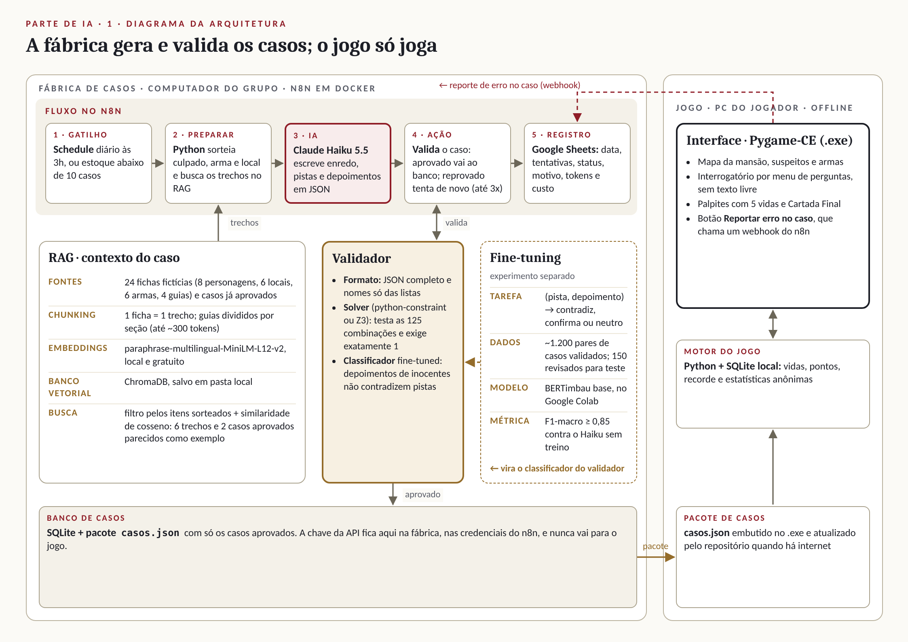

# Quem Foi?

Jogo de dedução para PC em que a IA cria um caso novo a cada partida, e um validador lógico garante que ele tem exatamente uma solução.

**Grupo Mentalistas:** Ana Luiza Lima Nicolodi, Alisson Silva Nascimento e Levi Ramos · Projeto de Inteligência Artificial


## O problema

Jogos de mistério acabam quando o caso é resolvido, e as escolas têm poucas ferramentas engajantes para treinar lógica e análise de evidências. O Quem Foi? é para estudantes a partir de 14 anos, professores e fãs de jogos de detetive: cada partida traz um caso novo e sem furos.

## Como se joga

De 1 a 3 jogadores, no mesmo computador, são detetives numa mansão. Revezando a vez, cada um joga o dado, anda pelo tabuleiro, coleta pistas e interroga suspeitos para descobrir **quem foi, com que arma e em que cômodo**.

- **Palpite:** só dentro de um cômodo e sobre esse cômodo. O jogo mostra só para quem palpitou o que acertou e o que errou. Se errou algo, perde 1 das 5 vidas.
- **Cartada Final:** acusar tudo de uma vez, na sua vez. Errou, está eliminado.
- **Pontos:** quem vence ganha 100, +20 por vida restante e +50 pela Cartada Final certa.

## Versão 1.0 (17/11/2026)

O jogo está completo e jogável: tabuleiro de 21 × 17 casas, dado animado, 1 a 3 jogadores, pistas, interrogatório, palpites, Cartada Final, vidas e pontos. Cada partida traz um caso novo: o jogo usa primeiro os casos escritos pela IA (pasta `dados/casos/ia/`) e, quando acabam, gera um caso na hora com o gerador local.

## Arquitetura



| Parte | O que faz | Tecnologia |
| --- | --- | --- |
| Fluxo no n8n | Gatilho → preparar → IA → validar → registrar, com até 3 tentativas | n8n self-hosted (`npx n8n`) chamando `fabrica/servidor.py` |
| Sorteio | O código sorteia culpado, arma, cômodo e monta os fatos de cada pista | `fabrica/gerador_local.py` |
| RAG | Busca as fichas dos itens sorteados e trechos dos guias | TF-IDF + similaridade de cosseno, índice em JSON (`fabrica/rag.py`) |
| LLM | Reescreve título, abertura, pistas e depoimentos em JSON | Gemini (Google AI Studio, nível gratuito) |
| Validador | Exige 1 solução entre as 150 combinações, só o culpado mente, nada entrega a resposta | `fabrica/validar.py` + checagens de texto em `fabrica/pipeline.py` |
| Fine-tuning | Detecta depoimentos que contradizem pistas | BERTimbau no Google Colab |
| Jogo | Interface offline, lê só casos aprovados | Pygame-CE |

A IA nunca decide a lógica do caso: o código monta, a IA escreve, o validador confere. A chave da API fica só no `.env` de quem roda a fábrica. O jogo não leva chave nenhuma.

## Pastas

| Pasta | Conteúdo |
| --- | --- |
| `dados/` | Personagens, armas, cômodos, tabuleiro, perguntas, detetives, paleta e `casos/` (exemplo e `ia/`) |
| `base_conhecimento/` | 24 documentos fictícios do RAG (personagens, armas, locais, guias) |
| `fabrica/` | RAG, gerador local, validador, pipeline com o Gemini, servidor do n8n e `prompts/` versionados |
| `n8n/` | Fluxo exportado do n8n e [como rodar](n8n/README.md) |
| `fine_tuning/` | Dados, linha de base, caderno do Colab e [resultados](fine_tuning/README.md) |
| `jogo/` | Jogo em Pygame-CE e a arte |
| `testes/` | Testes das regras e do gerador, e os [casos de teste da fábrica](docs/casos_de_teste.md) |
| `docs/` | [Regras oficiais](docs/regras.md), [formato do caso](docs/formato_caso.md), [roteiro dos QAs](docs/roteiro_testes.md) e imagens |

## Como rodar

Precisa do **Python 3.10 ou mais novo**. No Windows, use `py` no lugar de `python`.

### Jogo

```bash
pip install pygame-ce
python jogo/main.py
```

A janela se ajusta ao monitor. **F11** liga e desliga a tela cheia.

### Testes

```bash
python -m unittest discover testes      # 29 testes das regras e do gerador
python testes/casos_de_teste.py         # 10 casos de teste da fábrica + tempos (gera docs/casos_de_teste.md)
```

### Fábrica de casos com IA

1. Crie uma chave gratuita em **aistudio.google.com** (Get API key).
2. Copie `.env.example` para `.env` e cole a chave em `GEMINI_API_KEY=`. O `.env` nunca vai para o GitHub.
3. Gere casos (não precisa instalar nada, só Python):

```bash
python fabrica/rag.py --indexar                       # recria o índice do RAG (já vem pronto)
python fabrica/rag.py "álibi na adega"                # testa uma busca
python fabrica/pipeline.py --casos 5 --prompt v2      # gera 5 casos com o Gemini
python fabrica/pipeline.py --casos 5 --prompt v1      # mesmo teste com o prompt antigo
python fabrica/pipeline.py --casos 3 --simular        # testa o fluxo sem chamar a IA
```

Cada caso gera uma linha em `fabrica/registro.csv` (prompt, tentativas, tokens, tempo de cada etapa, custo). Os casos aprovados vão para `dados/casos/ia/` e aparecem no jogo.

**Pelo n8n:** veja [n8n/README.md](n8n/README.md).

**Conferir um caso:** `python fabrica/validar.py dados/casos/caso_exemplo.json`

## Arte

Toda a arte (tabuleiro, cômodos, suspeitos, detetives, armas, dado) foi criada pelo grupo em código, na paleta do jogo. Fica em `jogo/assets/`, e o gerador está em `jogo/arte_fonte/gerar_arte.py`. Não usa imagens de terceiros.

Todos os dados do projeto são fictícios e foram criados pelo grupo.
